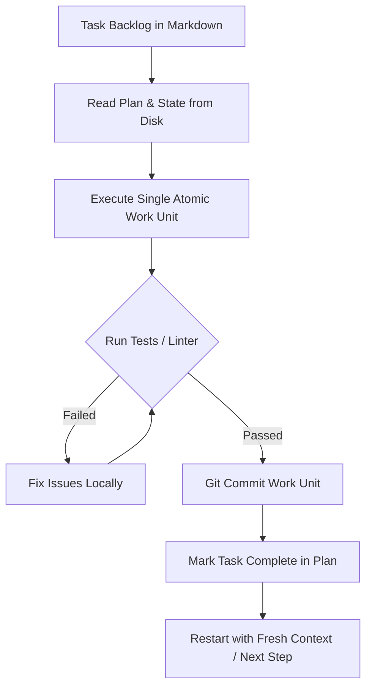

# Ralph Loop: Autonomous Iterative Execution Protocol

The **Ralph Loop** (conceived by Geoffrey Huntley) overcomes LLM context rot by treating the filesystem and Git as durable memory, rather than relying on a long-running chat session.

## Core Mechanics

## Operating Principles

1. **Disk as Truth**: The source code, test suite, and task list (e.g., `IMPLEMENTATION_PLAN.md`) represent the entire project state. Never assume facts not verifiable on disk.
2. **Fresh Context per Iteration**: For complex multi-phase features, focus strictly on one discrete task at a time. Conclude each phase with a clean state.
3. **Strict Backpressure**: No step is complete until automated checks pass (in Palateo: `npm run check` and `npm run update:csp`).
4. **Autonomous AFK Progress**:
   - Pick the next uncompleted task from the backlog.
   - Implement the minimal change.
   - Run verification checks.
   - Update checklist and record the milestone commit.
